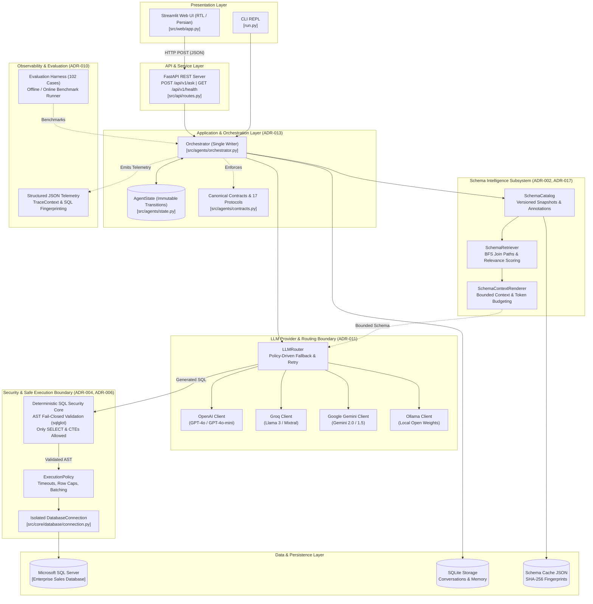

# MASTER PROJECT QUICK AUDIT REPORT

**Target Profile:** Mahdi Akrami — AI Engineer & Practitioner  
**Repository:** `text-to-SQL-agent`  
**Date of Audit:** 2026-09-23  
**Report File:** `PROJECT_AUDIT_REPORT.md`  

---

## 1. Project Overview

* **Project Name:** Text-to-SQL Agent (Enterprise Autonomous Natural Language Database Agent)
* **Suggested Professional Title:** Enterprise Autonomous Text-to-SQL Agent & Conversational Data Analytics Engine
* **Project Category:** Generative AI Systems / LLM Autonomous Agents / Enterprise Data Engineering & NLP
* **One-Line Description:** Production-grade, secure Text-to-SQL agent combining multi-provider LLM routing, deterministic AST security guardrails, schema intelligence, and bilingual Persian/English conversational analytics.
* **Short Professional Description:** An enterprise-grade AI agent designed to bridge natural language business questions and complex relational databases (Microsoft SQL Server, PostgreSQL, MySQL). Built with Clean Architecture and strict ADR governance, the system features a single-writer state orchestrator, deterministic AST-based SQL security validation, dynamic schema retrieval with context budgeting, multi-provider LLM fallback (OpenAI, Groq, Gemini, Ollama), an interactive RTL Streamlit web application, and a high-performance FastAPI REST service.
* **Main Problem:** Non-technical business stakeholders and decision-makers face severe bottlenecks accessing enterprise relational databases; simultaneously, raw LLM-generated SQL poses critical security risks (SQL injection, accidental data mutation, unbounded expensive queries), struggles with domain-specific schemas, and lacks robust localization for non-English business contexts (such as Persian semantics and Jalali calendar temporal operations).
* **Main Solution:** An end-to-end, deterministic agent orchestration pipeline that couples generative LLM reasoning with compile-time and runtime guardrails. The system decomposes user queries, retrieves relevant schema context, enforces AST-level read-only security before database execution, applies strict execution resource limits (timeouts, row limits, batching), translates column labels and business metrics, and delivers grounded natural language answers alongside interactive tabular results.
* **Target Users / Organization:** Enterprise data analysts, business intelligence teams, operational managers, and C-level executives in bilingual/Persian-speaking organizations requiring secure, self-service database analytics without writing SQL.
* **Current Project Status:** **Active / Production-Hardened Architecture** (Phase 3.2 completed; 1,064 automated tests passing; 17 Architectural Decision Records implemented; evaluation harness with 102 baseline test cases operational).

---

## 2. Architecture

### 2.1 Architectural Paradigm & Core Components
The system follows **Clean Architecture** and the **Hexagonal / Ports-and-Adapters** pattern, structured into clear, decoupled layers governed by 17 Architectural Decision Records (ADRs):

1. **Presentation Layer:**
   * **Streamlit Web UI (`src/web/app.py`):** Interactive conversational dashboard with full Right-to-Left (RTL) Persian CSS styling, tabular data rendering via pandas DataFrames, expandable SQL preview, and session management.
   * **CLI REPL (`run.py`):** Direct terminal-based interface for interactive querying and local debugging.
2. **API & Service Layer (`src/api/`):**
   * **FastAPI Application (`src/api/main.py`, `src/api/routes.py`):** High-performance asynchronous REST API exposing `/api/v1/ask` and `/api/v1/health` with Pydantic request/response models and global error encapsulation.
3. **Application & Orchestration Layer (`src/agents/`):**
   * **Single-Writer Orchestrator (`src/agents/orchestrator.py` — ADR-013):** Sole authorized writer of `AgentState`, advancing the pipeline across deterministic stages (`INITIALIZED` → `QUESTION_ANALYZED` → `SCHEMA_RESOLVED` → `PLAN_CREATED` → `SQL_GENERATED` → `VALIDATED` → `EXECUTED` → `RESULT_ANALYZED` → `ANSWERED`).
   * **Contract Authority (`src/agents/contracts.py` — ADR-012):** Canonical location for typed value objects, domain models, and 17 runtime-checkable `Protocol` interfaces.
   * **Façade Agent (`src/agents/text_to_sql_agent.py`):** Backward-compatible application entry point coordinating dependencies.
4. **Core Domain & Security Layer (`src/core/`):**
   * **AST Security Core (`src/core/security/sql_security.py` — ADR-004):** Deterministic, fail-closed SQL validator leveraging `sqlglot` to parse T-SQL into an Abstract Syntax Tree (AST), blocking all DML, DDL, multi-statement executions, dangerous stored procedures (`xp_cmdshell`, `sp_executesql`, `OPENROWSET`), and transaction controls.
   * **Schema Intelligence Subsystem (`src/core/schema/` — ADR-002, ADR-017, Phase 3.2):** 
     * `SchemaCatalog`: Single runtime owner of versioned schema snapshots with SHA-256 fingerprinting and semantic annotations.
     * `SchemaRetriever`: Deterministic entity/filter/metric routing and bounded BFS join-path relationship discovery.
     * `SchemaContextRenderer`: Formatting boundary enforcing hard character and token budgets with deterministic section-drop priorities.
   * **SQL Generation & Repair (`src/core/sql_extractor/`):** Few-shot prompt assembly, SQL codeblock extraction, heuristic syntax cleaning, and automated one-shot error repair loops.
   * **LLM Routing Subsystem (`src/core/llm/` — ADR-011):** Single architectural boundary (`LLMRouter`) managing policy-driven provider fallback (`OpenAI` → `Groq` → `Gemini` → `Ollama`), bounded retries, token/usage accounting, and normalized provider-neutral error handling.
5. **Database & Persistence Layer:**
   * **Safe Database Execution Boundary (`src/core/database/` — ADR-006):** Isolated per-query connections (`pymssql`), strict `ExecutionPolicy` (query timeout, login timeout, row limits, batch fetching via `cursor.fetchmany`), and typed database error codes (`DatabaseErrorCode`).
   * **Conversational Memory (`src/memory/`):** SQLite-backed multi-turn conversation storage (`data/conversations.db`) with session-based context isolation.
6. **Observability & Evaluation Foundation:**
   * **Structured Logging & Tracing (`src/utils/logger.py`):** ContextVars-based `TraceContext` (`X-Trace-ID`), SHA-256 SQL query fingerprinting, sensitive credential redaction, and JSON-formatted event telemetry.
   * **Continuous Evaluation Harness (`evaluation/` — ADR-010):** Executable evaluation runner supporting offline and online benchmarking against 102 canonical Persian enterprise analytical questions (`evaluation/baseline_questions.json`).

### 2.2 System Architecture Diagram



---

## 3. Technology Stack

### Languages
* **Python 3.11+:** Modern asynchronous backend, strict type annotations (`typing.Protocol`, `dataclasses`, `contextvars`).
* **T-SQL (Transact-SQL):** Dialect targeting Microsoft SQL Server, complex analytical queries, CTEs, window functions.
* **SQL:** Standard relational querying across SQLite, PostgreSQL, MySQL.

### AI / Machine Learning
* **Prompt Engineering & Metaprompting:** Dynamic few-shot generation, rule-constrained system prompts, chain-of-thought instructions.
* **Schema Intelligence & Retrieval (RAG for Structured Data):** Term-based relevance scoring, graph-based join-path discovery (BFS), context budgeting.
* **Abstract Syntax Tree (AST) Semantic Analysis:** Programmatic SQL parsing, semantic tree inspection, and syntax error categorization via `sqlglot`.
* **Empirical LLM Evaluation:** Automated test suite with 102 canonical Persian queries, failure classification, and performance metrics.

### LLM / Generative AI
* **OpenAI API & SDK (`openai >= 2.51.0`, `langchain-openai`):** Primary generation using `gpt-4o-mini` and `gpt-4o`.
* **Google Gemini API (`google-genai >= 2.16.0`):** Secondary LLM provider integration with native SDK.
* **Groq Cloud API (`langchain-groq >= 1.1.3`):** High-speed inference for Llama 3 models.
* **Ollama (`langchain-ollama >= 1.1.0`):** Local model serving for privacy-preserving, air-gapped on-premise execution.
* **LangChain Ecosystem (`langchain >= 1.3.14`):** Unified provider abstractions and chat interfaces.

### Backend
* **FastAPI (`>= 0.115.0`):** High-performance ASGI RESTful web framework.
* **Uvicorn (`>= 0.32.0`):** Production-ready asynchronous ASGI server.
* **Pydantic:** Data validation, request/response schema modeling.
* **Python Standard Library Dataclasses & Enums:** Pure domain modeling, immutable value objects.

### Frontend
* **Streamlit (`>= 1.60.0`):** Interactive data application framework.
* **Custom RTL CSS Styling:** Native Right-to-Left styling for Persian conversational interfaces.
* **Pandas (`>= 3.0.5`):** Data manipulation, tabular presentation, automated column translation mapping.

### Databases
* **Microsoft SQL Server (Target Database):** Enterprise operational database (`pymssql >= 2.3.13`, `pyodbc >= 5.3.0`).
* **SQLite3 (`data/conversations.db`):** Local conversational session and multi-turn message persistence.
* **PostgreSQL (`psycopg2-binary >= 2.9.12`) & MySQL (`pymysql >= 1.2.0`):** Multi-database driver support.
* **SQLAlchemy 2.0 (`>= 2.0.51`):** Database engine abstraction and metadata introspection.

### Frameworks & Libraries
* **`sqlglot >= 30.14.0`:** Fast SQL parser, transpiler, and AST inspection engine.
* **`hatchling`:** Modern PEP 517 build backend.
* **`python-dotenv >= 1.2.2`:** Environment configuration management.
* **`prettytable >= 3.18.0` & `markdown >= 3.10.3`:** CLI and text formatting.
* **`requests >= 2.32.0`:** HTTP client for API-to-UI communication.

### Infrastructure & DevOps
* **`uv` (Astral):** Ultra-fast Rust-based Python package and virtualenv manager.
* **Git:** Version control, multi-sprint branch management (`new-ar`).

### Developer Tools & Quality Assurance
* **Pytest (`>= 8.0`):** Comprehensive automated testing suite (1,064 tests).
* **Architecture AST Scanners:** Custom Python AST inspection tests ensuring strict layer boundaries and zero unauthorized cross-package imports.
* **CPython Audit Hooks & Filesystem Probes:** Behavioral verification proving lightweight modules produce no import-time side effects or socket connections.
* **`compileall`:** Complete repository bytecode compilation validation.

---

## 4. Key Features

### AI Features
* **Natural Language to T-SQL Translation:** High-accuracy translation of complex natural language questions into valid T-SQL queries.
* **Multi-Provider LLM Fallback Routing:** Automatic failover across OpenAI, Groq, Gemini, and Ollama with bounded retries and token budgeting.
* **Automated Self-Repair Loop:** Automatically captures syntax and validator errors, feeds context back to the LLM, and regenerates valid SQL.
* **Schema Intelligence & Context Budgeting:** Scores and selects relevant tables/columns and relationship join paths, fitting strictly within token boundaries without context bloat.
* **Bilingual Response Generation:** Delivers structured Persian narrative insights alongside English technical queries and data tables.

### Backend Features
* **RESTful FastAPI Service:** Asynchronous `/api/v1/ask` and `/api/v1/health` endpoints returning standardized JSON payloads.
* **Single-Writer Orchestrator State Machine:** Centralized pipeline tracking through immutable state objects, preventing race conditions.
* **Typed Error Code Hierarchy (ADR-015):** Granular error classification (`QUESTION`, `SCHEMA`, `PLANNING`, `SECURITY`, `VALIDATION`, `EXECUTION`, `LLM`, `INTERNAL`) ensuring graceful failure reporting.

### Data & Security Features
* **Deterministic AST SQL Security Core (ADR-004):** Parses queries with `sqlglot`; enforces strict single-statement, read-only policies (allowing only `SELECT` and `WITH` CTEs); unconditionally rejects all DDL, DML, execution calls, and transaction controls.
* **Safe Execution Resource Limits (ADR-006):** Isolated per-request database connections, explicit query and connection timeouts, row caps (`max_rows`), and batched fetching (`max_fetch_batch`).
* **Automated Column Translation & ID Stripping:** Automatic LLM-assisted generation of Persian column mappings (`column_mapper.py`) with automatic schema-hash drift detection and suppression of internal primary/foreign keys (`*Id`).
* **Jalali / Solar Hijri Calendar Support:** Specialized understanding of Persian temporal dimensions (`jalaliYearNo`, `operationMonth`, solar dates) against enterprise sales data.

### User Features
* **Bilingual RTL Streamlit Interface:** User-friendly web interface with full Persian RTL alignment, real-time message streaming, and table rendering.
* **Expandable SQL Inspection:** Transparent visibility into generated SQL code for auditability and verification.
* **Multi-Turn Conversational Memory:** Preserves session history across user turns, enabling follow-up questions and iterative data exploration.

### Developer & System Features
* **Architecture Boundary Testing:** Dedicated test suite using AST parsing to statically enforce Clean Architecture import rules.
* **End-to-End Evaluation Harness (ADR-010):** Standalone benchmark runner evaluating 102 canonical queries across 18 difficulty and functional categories.
* **Structured JSON Observability:** Context-propagated tracing (`X-Trace-ID`), SQL query SHA-256 fingerprinting, execution time profiling, and automated credential redaction.

---

## 5. AI / LLM Capabilities

* **Supported Models:** OpenAI (`gpt-4o-mini`, `gpt-4o`), Groq-hosted open models (e.g. `llama-3.1-70b`), Google Gemini (`gemini-2.0-flash`, `gemini-1.5-pro`), and Ollama local models (`mistral`, `llama3`).
* **LLM Routing Subsystem (`LLMRouter`):**
  * Configuration-driven routing chain (`LLM_PROVIDER_ORDER = "openai,groq,gemini,ollama"`).
  * Policy-driven execution with per-call `LLMPolicy` overrides.
  * Bounded retry on execution/network failures (skipping configuration errors).
  * Error normalization translating proprietary SDK exceptions into provider-neutral exceptions (`LLMProviderTimeout`, `LLMProviderRateLimited`, `LLMProviderUnavailable`).
* **Schema Intelligence & RAG for SQL:**
  * `SchemaCatalog`: Maintains versioned database snapshots with SHA-256 fingerprints, merging structural metadata with business annotations.
  * `SchemaRetriever`: Computes term-matching relevance scores between question entities/metrics and schema elements; performs bounded Breadth-First Search (BFS) over schema foreign keys to discover valid join paths.
  * `SchemaContextRenderer`: Enforces hard character ceilings (default 8,000 chars) with deterministic section-dropping (dropping semantics first, notes second, non-endpoint columns third, failing closed if base structural floor cannot fit).
* **Deterministic Guardrails & Evaluation:**
  * Complete separation between generative AI components and deterministic validators.
  * AST validation ensures that LLMs can never bypass security policies via prompt injection.
  * Continuous evaluation dataset (`baseline_questions.json`) tracking accuracy, safety rejections, and execution fidelity.

---

## 6. Database & Data Layer

* **Primary Database Engine:** Microsoft SQL Server (specifically tested against enterprise sales schema: `Sale.Orders`, `Sale.OrderItems`, `Sale.Shipments`).
* **Multi-Dialect Compatibility:** Pre-configured drivers for PostgreSQL, MySQL, SQLite, and Microsoft SQL Server via SQLAlchemy.
* **Connection Lifecycle & Isolation:**
  * Request-scoped ephemeral connections prevent state contamination or lingering locks.
  * Unbounded `fetchall()` is strictly replaced by batch-fetched cursor loops respecting `ExecutionPolicy.max_rows` (default 1,000) and `ExecutionPolicy.max_fetch_batch` (default 100).
  * Enforced query timeouts (default 30s) and login timeouts (default 5s).
* **Conversational Memory Database:** SQLite database (`data/conversations.db`) managing `sessions` and `messages` tables with indexed timestamp retrieval.
* **Metadata & Schema Caching:** Content-addressed JSON caching (`data/schema/schema_cache.json` and `.schema_cache.json`) for fast, offline-capable schema snapshots.

---

## 7. APIs & Integrations

* **RESTful Endpoints:**
  * `POST /api/v1/ask`: Accepts `{ "question": str, "session_id": Optional[str] }`; executes full agent pipeline; returns `{ "success": bool, "question": str, "answer": str, "sql": str, "row_count": int, "rows": list[dict], "error": Optional[str], "session_id": str }`.
  * `GET /api/v1/health`: Returns service health and configuration status for database and LLM providers.
* **External Provider APIs:**
  * OpenAI API (Chat Completions)
  * Groq Cloud Inference API
  * Google AI Studio / Gemini API
  * Local Ollama HTTP API (`http://localhost:11434`)
* **Database Integrations:** Direct socket communication to Microsoft SQL Server via `pymssql` and `pyodbc`.

---

## 8. Engineering & Development

* **Software Architecture:** Clean Architecture, Hexagonal / Ports-and-Adapters, Domain-Driven Design (DDD) principles.
* **Architectural Decision Records (ADRs):** Comprehensive documentation of 17 foundational decisions (ADR-001 through ADR-017).
* **Single-Writer State Pattern (ADR-013):** Eliminates hidden mutable state and race conditions by restricting `AgentState` mutation solely to `Orchestrator`.
* **Static Architecture & Boundary Enforcement:** Automated pytest suite (`test_architecture/`) utilizing Python's `ast` module to statically verify that:
  * External database drivers (`pymssql`, `sqlite3`) never leak into domain contracts or application services.
  * External LLM SDKs (`openai`, `google-genai`) are isolated exclusively behind `src/core/llm/`.
  * Framework imports (`fastapi`, `streamlit`) remain quarantined in presentation/API modules.
  * Lightweight modules execute zero side-effects at import time (verified via fresh subprocess CPython audit hooks).
* **Deterministic Security Engineering:** Replaced vulnerable regex/keyword blocklists with an AST-based parser (`sqlglot`), implementing fail-closed security.
* **Observability & Telemetry:** Context-propagated tracing (`TraceContext` via `contextvars`), unique `trace_id` in API headers (`X-Trace-ID`), SHA-256 SQL fingerprinting, and automatic redaction of sensitive credentials.
* **Automated Testing Suite:** 
  * **1,064 automated unit, integration, and architecture tests passing** (with 356 intentional matrix skips; 0 failures).

---

## 9. Skills Demonstrated by This Project

### Strong Evidence (Central to the Project)
* **Autonomous AI Agent Architecture:** Multi-stage orchestration, single-writer state machines, layered pipeline coordination.
* **LLM Engineering & Provider Routing:** Multi-provider fallback systems (OpenAI, Groq, Gemini, Ollama), bounded retries, token budgeting, error normalization.
* **AI Security & Guardrails:** AST-based SQL parsing (`sqlglot`), fail-closed deterministic validation, prompt injection defense, DML/DDL execution blocking.
* **Clean Architecture & Interface Design:** Protocol-based decoupled design (Python `typing.Protocol`), Dependency Injection, Ports-and-Adapters, ADR documentation.
* **Schema Intelligence & Structured RAG:** Schema cataloging, graph-based join-path resolution (BFS), semantic annotation merging, context budgeting.
* **Database Engineering & Safe Execution:** Resource-bounded SQL execution, connection lifecycle management, query timeout enforcement, Microsoft SQL Server (T-SQL).
* **RESTful API Development:** FastAPI, asynchronous endpoints, Pydantic data schemas, structured error envelopes.
* **Automated Testing & Architecture Verification:** Pytest, AST static analysis for architectural boundary enforcement, CPython audit hooks.
* **Persian NLP & Localization:** Persian natural language generation, Right-to-Left (RTL) interface engineering, Jalali calendar domain adaptation.

### Working Knowledge (Meaningfully Used)
* **Full-Stack Prototyping:** Streamlit dashboard development, custom CSS injection, conversational UI state management.
* **Observability & Telemetry:** Structured JSON logging, `contextvars` request tracing, SQL fingerprinting, sensitive data sanitization.
* **Evaluation Frameworks:** Test benchmark runner design, dataset curation (102 queries), offline/online execution analysis.
* **Package Management & Tooling:** Astral `uv`, `pyproject.toml`, Hatchling build backend.
* **Local LLM Deployment:** Ollama setup and local model invocation.

### Familiar / Limited (Touched or Integrated)
* **Alternative Relational Databases:** PostgreSQL (`psycopg2`), MySQL (`pymysql`), SQLite3.
* **Object-Relational Mapping (ORM):** SQLAlchemy 2.0 metadata inspection.
* **Data Visualization & Analytics:** Pandas tabular data structures, Markdown report generation.

---

## 10. CV-Ready Project Entry

### Project Title
**Enterprise Autonomous Text-to-SQL Agent & Conversational Data Engine**

### Description
Architected a production-grade, bilingual (Persian/English) Text-to-SQL autonomous agent enabling non-technical enterprise users to securely query Microsoft SQL Server databases using natural language. Designed with Clean Architecture and governed by 17 Architectural Decision Records (ADRs), the system integrates multi-provider LLM routing, AST-based security guardrails, schema intelligence, and a responsive RTL Streamlit web interface.

### Key Contributions
* **Architected Single-Writer State Orchestrator:** Engineered a deterministic, 9-stage pipeline state machine (`Orchestrator`) with immutable state transitions and 17 component protocols, eliminating race conditions and direct component coupling.
* **Developed Deterministic AST Security Core:** Built a fail-closed SQL security gate utilizing `sqlglot` AST parsing, strictly enforcing single-statement read-only execution (`SELECT`/CTEs) and permanently eliminating SQL injection, DDL/DML mutations, and execution vulnerabilities.
* **Engineered Multi-Provider LLM Fallback Router:** Implemented an intelligent routing engine (`LLMRouter`) providing seamless failover across OpenAI (GPT-4o), Groq (Llama-3), Google Gemini, and local Ollama instances with bounded retries and token budgeting.
* **Constructed Schema Intelligence & Graph Join Subsystem:** Designed an automated schema catalog with SHA-256 fingerprinting, dynamic BFS join-path resolution, and bounded context rendering to prevent LLM context-window bloat.
* **Built Full-Stack API & Persian RTL Interface:** Developed high-throughput asynchronous FastAPI endpoints and an interactive Streamlit conversational dashboard featuring full Right-to-Left (RTL) styling and automated column translation.
* **Implemented Rigorous Testing & Evaluation Net:** Created an automated evaluation harness with 102 canonical enterprise queries and maintained an automated test suite of **1,064 passing tests**, including custom AST-based architecture boundary verification.

### Technologies
Python 3.11+, T-SQL, Microsoft SQL Server, FastAPI, Streamlit, LangChain, OpenAI API, Groq, Google Gemini, Ollama, `sqlglot`, SQLite, Pydantic, Pandas, Pytest, `uv`, Clean Architecture.

---

## 11. Portfolio Content

### 1. Overview
An enterprise AI solution that democratizes access to relational databases by translating complex natural language questions into high-performance T-SQL queries. It provides executive-level Persian summaries, interactive data tables, and full query transparency while enforcing strict security and resource controls.

### 2. The Problem
Enterprise databases contain vital operational data, but querying them requires deep SQL expertise. Traditional LLM-to-SQL implementations introduce serious security hazards (SQL injection, accidental deletion, runaway queries), hallucinate non-existent database columns, fail to handle non-English business terminology, and collapse when full database schemas exceed LLM context windows.

### 3. The Solution
A multi-tier agent architecture combining generative LLMs with deterministic software engineering. The solution introduces a single-writer orchestrator, AST-level SQL security validation, dynamic schema retrieval, safe connection pooling with resource limits, and automated Persian localization with Jalali date intelligence.

### 4. Technical Architecture
* **Presentation:** Streamlit conversational UI with native RTL CSS support.
* **API:** Asynchronous FastAPI service (`/api/v1/ask`, `/api/v1/health`).
* **Core Orchestration:** Immutable `AgentState` managed exclusively by `Orchestrator` across 9 distinct lifecycle stages.
* **Security Gate:** AST validation with `sqlglot`, blocking non-`SELECT` statements, dangerous system procedures, and transaction controls.
* **Schema Intelligence:** Versioned `SchemaCatalog`, BFS join-path finder, and bounded context renderer.
* **LLM Boundary:** Dynamic router supporting OpenAI, Groq, Gemini, and Ollama with automated failover.
* **Database Boundary:** Resource-bounded `DatabaseConnection` (`pymssql`) with query timeouts and row caps.

### 5. Technical Highlights
* **Zero Trust SQL Execution:** SQL statements are treated as untrusted code and analyzed via AST before any database connection is created.
* **Zero Leakage Architecture:** Custom pytest AST scanners statically verify that low-level database drivers and provider SDKs never leak into business contracts.
* **High Reliability:** Automated test suite with **1,064 passing tests** across unit, integration, and architecture layers.
* **Multi-Turn Context:** SQLite-backed memory preserving conversational context for complex follow-up queries.

### 6. Visuals & Screenshots Guide
* **Web UI Dashboard:** Streamlit conversational view showing Persian prompt, narrative answer, data table, and expandable SQL viewer.
* **Architecture Diagram:** Multi-tier architectural diagram illustrating data and security flow.
* **Security Rejection Demo:** Screenshot showing the system intercepting and blocking a destructive query (`DELETE FROM Sale.Orders`).
* **Evaluation Matrix:** Benchmark comparison table evaluating query categories.

### 7. Current Status
Production-hardened architecture with Phase 3.2 completed. Ready for enterprise self-hosted deployment on Docker or on-premise infrastructure.

---

## 12. Visual Assets

While static image files are intentionally not committed to git to maintain a lean repository footprint, the following existing assets, diagrams, and UI modules provide immediate visual and architectural evidence:

| Asset / File Path | Type | Description / Representation |
|---|---|---|
| `docs/current-system/current-architecture.md` (Lines 12–53) | Mermaid Diagram | Visual representation of current multi-layer system architecture, frontends, core components, and data stores. |
| `docs/architecture/sequence-diagrams.md` | Markdown & Diagrams | Complete sequence flows covering question analysis, schema resolution, SQL generation, AST security validation, and database execution. |
| `src/web/app.py` (Lines 58–177) | Interactive Web UI | Streamlit application with custom Right-to-Left (RTL) Persian CSS styling, chat bubble styling, pandas DataFrame tables, and expandable SQL viewer. |
| `report.md` | Empirical Test Case Report | Detailed report containing actual outputs for analytical queries (Jalali year sales calculation) and live security rejection demonstrations (`DELETE` query blocked). |
| `evaluation/baseline_questions.json` | Benchmark Dataset | 102 canonical Persian test questions across 18 analytical and security categories. |
| `artifacts/evaluation/` | Benchmark Artifacts | Serialized JSON run artifacts comparing baseline model runs and offline evaluations. |

---

## 13. SKILLS TO ADD TO MASTER CV

```text
Languages:
Python (3.11+), T-SQL (Transact-SQL), SQL (PostgreSQL, MySQL, SQLite)

AI / ML:
Prompt Engineering, Few-Shot Learning, In-Context Learning, Structured RAG, LLM Evaluation & Benchmarking, NLP (Bilingual / Persian)

LLM / Generative AI:
OpenAI API (GPT-4o, GPT-4o-mini), Google Gemini API, Groq Cloud API, Ollama (Local Models), LangChain, Multi-Provider Fallback Routing, Token Budgeting

Backend:
FastAPI, Asynchronous Python (asyncio), Uvicorn, RESTful API Design, Pydantic, Clean Architecture, Hexagonal Architecture, Ports & Adapters, State Machine Design (Single-Writer Pattern)

Frontend:
Streamlit, Conversational UI Engineering, RTL (Right-to-Left) CSS Localization

Databases:
Microsoft SQL Server (pymssql, pyodbc), SQLite, PostgreSQL (psycopg2), MySQL (pymysql), SQLAlchemy, Relational Schema Design, Query Optimization

Frameworks / Libraries:
sqlglot (AST Parsing & SQL Transpilation), Pandas, Pytest, Hatchling, Dotenv

DevOps / Infrastructure:
uv (Astral Package Manager), Git, Virtual Environments, Docker-ready Architecture

Tools & Practices:
Architectural Decision Records (ADRs), AST Architecture Testing, CPython Audit Hooks, Structured Telemetry & Tracing (ContextVars), SQL Query Fingerprinting, Fail-Closed Security Engineering
```

---

## 14. Executive Summary

* **What the Project Is:** Text-to-SQL Agent is an enterprise-grade autonomous AI system that translates natural language business questions into optimized, secure T-SQL queries against Microsoft SQL Server databases.
* **What Problem It Solves:** It eliminates the bottleneck between business users and relational databases, while solving the critical vulnerabilities of raw LLM code generation (SQL injection, data destruction, schema hallucination, and context bloat) and delivering specialized Persian/Jalali analytics.
* **Main Architecture:** Built on Clean Architecture with 17 formal Architectural Decision Records (ADRs). It features an immutable Single-Writer State Orchestrator, an AST-based SQL Security Core, dynamic Schema Intelligence, a multi-provider LLM Router (OpenAI, Groq, Gemini, Ollama), a safe database execution boundary, a FastAPI REST service, and a Persian RTL Streamlit web UI.
* **Most Important Technologies:** Python 3.11+, T-SQL, Microsoft SQL Server, FastAPI, Streamlit, `sqlglot` (AST parser), LangChain, OpenAI, Groq, Gemini, Ollama, SQLite, and `uv`.
* **Most Important AI Capabilities:** Multi-provider fallback routing, dynamic few-shot learning, graph-based join-path retrieval (BFS), bounded schema context budgeting, automated SQL error correction, and bilingual natural language response generation.
* **Most Relevant Skills for Mahdi Akrami's CV:** Autonomous Agent Architecture, AI Guardrails & Deterministic Security, Multi-LLM Routing & Fallback, Clean Architecture & Interface Design, Enterprise Text-to-SQL, AST Analysis with `sqlglot`, and Production-Grade Automated Testing (1,064 passing tests).
