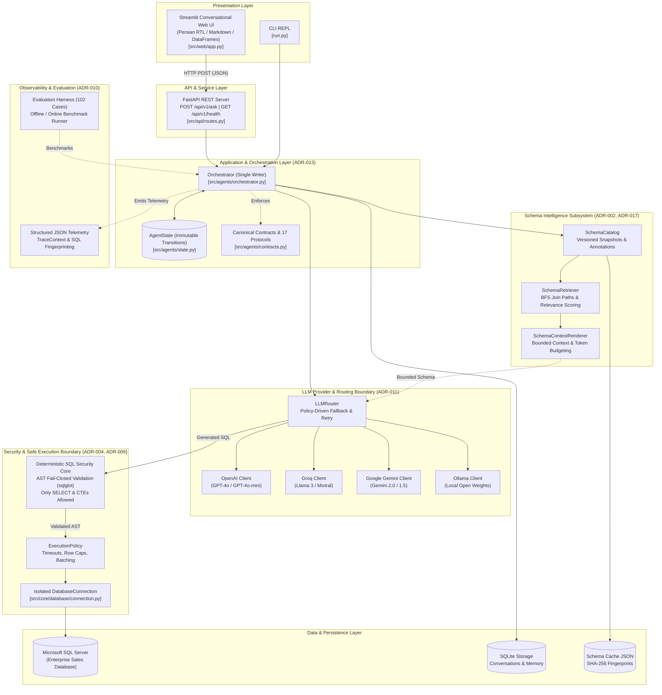
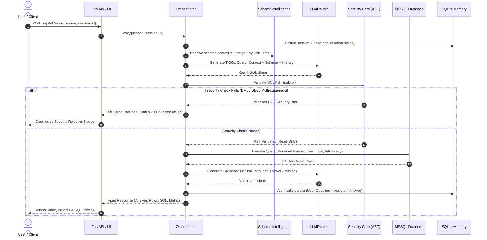

# Enterprise Autonomous Text-to-SQL Agent & Conversational Data Engine

[](https://www.python.org/downloads/)
[](https://fastapi.tiangolo.com)
[](https://streamlit.io)
[](docs/architecture/package-architecture.md)
[](docs/adr/)
[](tests/)
[](docs/security/sql-security-policy.md)
[](https://docs.astral.sh/uv/)

An enterprise-grade, autonomous **Text-to-SQL AI Agent** designed to bridge natural language business questions and relational databases (Microsoft SQL Server / T-SQL). Built with **Clean Architecture**, **Hexagonal Ports-and-Adapters**, and governed by **17 Architectural Decision Records (ADRs)**.

The system combines multi-provider LLM fallback routing, deterministic Abstract Syntax Tree (AST) security guardrails, schema intelligence with graph join-path discovery, bilingual Persian/English conversational analytics, and bounded resource execution.

---

## Table of Contents

- [Key Architecture Highlights](#key-architecture-highlights)
- [System Architecture Diagram](#system-architecture-diagram)
- [End-to-End Pipeline Sequence](#end-to-end-pipeline-sequence)
- [Core Engineering Pillars](#core-engineering-pillars)
  - [1. Deterministic AST SQL Security Core](#1-deterministic-ast-sql-security-core)
  - [2. Multi-Provider LLM Fallback Routing](#2-multi-provider-llm-fallback-routing)
  - [3. Schema Intelligence & Structured RAG](#3-schema-intelligence--structured-rag)
  - [4. Single-Writer State Orchestration](#4-single-writer-state-orchestration)
  - [5. Bounded Execution Policy](#5-bounded-execution-policy)
  - [6. Observability, Telemetry & Evaluation](#6-observability-telemetry--evaluation)
  - [7. Bilingual & Persian Localization](#7-bilingual--persian-localization)
- [Repository Structure](#repository-structure)
- [Getting Started](#getting-started)
  - [Prerequisites](#prerequisites)
  - [Installation with UV](#installation-with-uv)
  - [Environment Configuration](#environment-configuration)
- [Running the Applications](#running-the-applications)
  - [1. FastAPI REST Service](#1-fastapi-rest-service)
  - [2. Streamlit Conversational Web UI](#2-streamlit-conversational-web-ui)
  - [3. Terminal CLI REPL](#3-terminal-cli-repl)
  - [4. Evaluation Benchmark Runner](#4-evaluation-benchmark-runner)
- [Testing & Quality Assurance](#testing--quality-assurance)
- [Architectural Decision Records (ADRs)](#architectural-decision-records-adrs)
- [License](#license)

---

## Key Architecture Highlights

- **Zero-Trust SQL Execution**: SQL is treated as untrusted code. No query touches the database without passing through `sqlglot` AST syntactic and semantic validation.
- **Fail-Closed Security**: Only single-statement read-only queries (`SELECT` and CTEs) are permitted. Multi-statements, DML, DDL, transaction commands, and dangerous system procedures (`xp_cmdshell`, `sp_executesql`, `OPENROWSET`) are deterministically rejected.
- **Single-Writer State Machine**: Strict single-writer ownership of `AgentState` by `Orchestrator` across 9 distinct lifecycle stages, preventing race conditions and hidden mutations.
- **High Availability LLM Routing**: Policy-driven fallback chain (`OpenAI` -> `Groq` -> `Gemini` -> `Ollama`) with bounded retries, token budgeting, and provider-neutral error normalization.
- **Dynamic Schema Intelligence**: Graph-based (BFS) relationship join-path discovery, entity-driven relevance scoring, and deterministic context budgeting preventing prompt bloat.
- **Rigorous Test Suite**: **1,064 automated unit, integration, and architecture tests passing** with 0 failures, including custom Python AST scanners for layer boundary verification.

---

## System Architecture Diagram



---

## End-to-End Pipeline Sequence



---

## Core Engineering Pillars

### 1. Deterministic AST SQL Security Core
- **Authoritative Gatekeeper**: Based on `sqlglot` parsing of the T-SQL dialect ([ADR-004](docs/adr/ADR-004-deterministic-security-validation.md)).
- **Rule Verification**:
  - Only root `SELECT` and `WITH ... SELECT` queries are allowed.
  - Rejects comments containing bypass sequences, stacked statements (`SELECT 1; DROP TABLE ...`), and non-deterministic commands.
  - Hard blocks DDL (`CREATE`, `ALTER`, `DROP`, `TRUNCATE`) and DML (`INSERT`, `UPDATE`, `DELETE`, `MERGE`).
  - Forbids high-privilege system stored procedures (`xp_cmdshell`, `sp_executesql`, `sp_configure`) and SQL file interactions (`OPENROWSET`, `BULK INSERT`).

### 2. Multi-Provider LLM Fallback Routing
- **Architectural Boundary**: Centralized in `LLMRouter` ([ADR-011](docs/adr/ADR-011-llm-routing.md)).
- **Configurable Hierarchy**: Default priority `openai` -> `groq` -> `gemini` -> `ollama`.
- **Reliability & Resilience**:
  - Bounded retry loops for network timeouts and transient HTTP 5xx errors.
  - Normalizes vendor-specific exceptions into standard typed domain errors (`LLMProviderTimeout`, `LLMProviderRateLimited`, `LLMProviderUnavailable`).
  - Zero provider SDK leakage into application contracts or orchestrator state.

### 3. Schema Intelligence & Structured RAG
- **SchemaCatalog**: Single authority for versioned schema snapshots with SHA-256 fingerprinting and semantic annotations ([ADR-017](docs/adr/ADR-017-canonical-schema-representation.md)).
- **Graph Join-Path Discovery**: Bounded Breadth-First Search (BFS) over database foreign keys to identify valid join paths between entity endpoints without hallucinating table links.
- **Context Budgeting**: `SchemaContextRenderer` strictly caps token/character budgets (8,000 char floor) using deterministic drop priorities (notes first, non-endpoint columns second, preserving core structural joins).

### 4. Single-Writer State Orchestration
- **Single-Writer Pattern**: `AgentState` is strictly owned and written by `Orchestrator` ([ADR-013](docs/adr/ADR-013-single-writer-of-agent-state.md)).
- **Deterministic 9-Stage Pipeline**:
  `INITIALIZED` &rarr; `QUESTION_ANALYZED` &rarr; `SCHEMA_RESOLVED` &rarr; `PLAN_CREATED` &rarr; `SQL_GENERATED` &rarr; `VALIDATED` &rarr; `EXECUTED` &rarr; `RESULT_ANALYZED` &rarr; `ANSWERED`.
- **Contracts Authority**: 17 runtime-checkable `Protocol` interfaces in `src/agents/contracts.py` ([ADR-012](docs/adr/ADR-012-component-contract-authority.md)).

### 5. Bounded Execution Policy
- **Database Boundary**: Managed through `ExecutionPolicy` ([ADR-006](docs/adr/ADR-006-safe-execution-boundary.md)).
- **Safety Controls**:
  - Query timeout enforcement (default: 30 seconds).
  - Connection login timeout (default: 5 seconds).
  - Row cap limits (`max_rows`: 1,000).
  - Cursor batch fetching (`fetchmany(max_fetch_batch=100)`) preventing server memory exhaustion.
  - Ephemeral request-scoped connections preventing lock contention.

### 6. Observability, Telemetry & Evaluation
- **Tracing**: Request-scoped `TraceContext` (`contextvars`) propagating `X-Trace-ID` across HTTP headers, logs, and database spans.
- **SQL Fingerprinting**: SHA-256 query hashing for telemetry deduplication without leaking sensitive values.
- **Evaluation Harness**: Standalone benchmark runner ([ADR-010](docs/adr/ADR-010-continuous-evaluation.md)) testing 102 canonical Persian enterprise business queries across 18 difficulty categories.

### 7. Bilingual & Persian Localization
- **Persian Analytical Capabilities**: Native understanding of Jalali (Solar Hijri) calendar temporal queries (e.g. `jalaliYearNo`, quarterly periods, solar months).
- **Automated Column Translation**: Background schema drift detection and Persian translation mapping (`column_mapper.py`) with automatic suppression of internal primary/foreign keys (`*Id`).
- **Right-to-Left (RTL) Interface**: Native Persian conversational UI in Streamlit with custom CSS typography.

---

## Repository Structure

```text
.
├── src/
│   ├── agents/               # Application orchestration layer
│   │   ├── contracts.py      # Canonical typed contracts & 17 Protocols (ADR-012)
│   │   ├── orchestrator.py   # Single-writer state machine orchestrator (ADR-013)
│   │   ├── state.py          # Immutable AgentState & transition graph
│   │   └── text_to_sql_agent.py # Public façade and composition root
│   ├── api/                  # FastAPI REST service layer
│   │   ├── main.py           # Application entrypoint & middleware
│   │   ├── routes.py         # /ask & /health endpoints
│   │   └── models.py         # Pydantic request & response schemas
│   ├── core/                 # Core domain & infrastructure
│   │   ├── database/         # Database connection & ExecutionPolicy (ADR-006)
│   │   ├── llm/              # Multi-provider LLMRouter & client adapters (ADR-011)
│   │   ├── schema/           # SchemaCatalog, Retriever & Renderer (ADR-017)
│   │   ├── security/         # Deterministic AST SQL Security Core (ADR-004)
│   │   └── sql_extractor/    # Prompt templates, extraction & error repair
│   ├── memory/               # SQLite conversation history manager (ADR-009)
│   └── web/                  # Streamlit RTL conversational UI dashboard
├── docs/
│   ├── adr/                  # 17 Architectural Decision Records
│   ├── architecture/         # Layering, dependency rules & guides
│   ├── contracts/            # Component contracts & interface specs
│   └── sprints/              # Sprint reports & evidence milestones
├── evaluation/               # Benchmark runner & 102 canonical test questions
├── tests/                    # 1,064 automated unit, integration & architecture tests
├── pyproject.toml            # Project metadata & dependency definitions
├── uv.lock                   # Deterministic lockfile
├── run.py                    # Terminal CLI launcher
├── run_api.py                # FastAPI ASGI launcher
└── run_ui.py                 # Streamlit UI launcher
```

---

## Getting Started

### Prerequisites
- **Python 3.11+** installed.
- **[uv](https://docs.astral.sh/uv/)** installed (`pip install uv` or via standalone installer).
- Access to **Microsoft SQL Server** (or compatible dialect).
- An API key for at least one supported provider: **OpenAI**, **Groq**, or **Google Gemini** (or local **Ollama** running).

### Installation with UV

```bash
# 1. Clone the repository
git clone https://github.com/ME0W004/text-to-SQL-agent.git
cd text-to-SQL-agent

# 2. Create virtual environment
uv venv

# 3. Activate virtual environment
# Windows:
.venv\Scripts\activate
# Linux / macOS:
source .venv/bin/activate

# 4. Synchronize dependencies from lockfile
uv sync
```

### Environment Configuration

Copy the example environment template:

```bash
cp .env.example .env
```

Configure your `.env` file:

```env
# Database Credentials (Microsoft SQL Server)
DB_HOST=localhost
DB_PORT=1433
DB_USER=your_db_username
DB_PASSWORD=your_secure_password
DB_NAME=your_enterprise_database

# API Service Configuration
API_URL=http://localhost:8000/api/v1

# LLM Providers (Configure at least one)
OPENAI_API_KEY=sk-...
GROQ_API_KEY=gsk_...
GOOGLE_API_KEY=AIzaSy...

# LLM Routing Fallback Order
LLM_PROVIDER_ORDER=openai,groq,gemini,ollama
OLLAMA_BASE_URL=http://localhost:11434
```

---

## Running the Applications

### 1. FastAPI REST Service

Start the asynchronous REST API server on `http://localhost:8000`:

```bash
python run_api.py
```

* Interactive OpenAPI Docs: `http://localhost:8000/docs`
* Health Check: `GET http://localhost:8000/api/v1/health`
* Ask Endpoint: `POST http://localhost:8000/api/v1/ask`

**Example Request:**
```bash
curl -X POST "http://localhost:8000/api/v1/ask" \
     -H "Content-Type: application/json" \
     -d '{"question": "مجموع فروش در سال ۱۴۰۲ چقدر بوده است؟"}'
```

### 2. Streamlit Conversational Web UI

Launch the interactive web application on `http://localhost:8501`:

```bash
python run_ui.py
```

Features:
- Native Right-to-Left (RTL) Persian typography.
- Interactive Pandas DataFrames for query outputs.
- Expandable SQL inspection tab for complete transparency.
- Multi-turn conversation retention per session.

### 3. Terminal CLI REPL

For interactive terminal querying and development:

```bash
python run.py
```

### 4. Evaluation Benchmark Runner

Execute the benchmark suite against the 102 canonical Persian test queries:

```bash
python -m evaluation.run
```

---

## Testing & Quality Assurance

The codebase enforces strict architecture boundaries, deterministic security rules, and type purity.

```bash
# Run the complete test suite
uv run python -m pytest tests -q

# Run architecture boundary tests (AST scanners & CPython audit hooks)
uv run python -m pytest tests/test_architecture -q

# Run deterministic SQL security tests
uv run python -m pytest tests/test_security -q

# Verify bytecode compilation across all modules
uv run python -m compileall -q src evaluation scripts tests
```

**Test Suite Metrics:**
```text
======================= 1064 passed, 356 skipped in 149.50s =======================
Bytecode Compilation: Clean (0 errors)
```

---

## Architectural Decision Records (ADRs)

The architectural evolution is governed by 17 formal ADRs located in [`docs/adr/`](docs/adr/):

| ADR | Title | Key Decision |
|---|---|---|
| **ADR-001** | Separate Understanding & Generation | Decouples natural language intent parsing from SQL generation. |
| **ADR-002** | Schema Intelligence Subsystem | Replaces raw schema dumps with indexed, searchable catalogs. |
| **ADR-003** | Query Planner | Introduces typed query plans between understanding and generation. |
| **ADR-004** | Deterministic Security Validation | Replaces regex guards with AST-level `sqlglot` read-only parsing. |
| **ADR-005** | Semantic Validation | Validates business logic, joins, and aggregates prior to execution. |
| **ADR-006** | Safe Execution Boundary | Enforces connection isolation, timeouts, row limits, and batching. |
| **ADR-007** | Result Analysis | Categorizes result sets (empty, scalar, tabular, extreme). |
| **ADR-008** | Presentation Planning | Formats output data structures independently from answer generation. |
| **ADR-009** | Layered Memory | Manages multi-turn conversation context across session boundaries. |
| **ADR-010** | Continuous Evaluation | Establishes regression benchmarking with 102 canonical queries. |
| **ADR-011** | LLM Routing Subsystem | Centralizes multi-provider fallback (OpenAI, Groq, Gemini, Ollama). |
| **ADR-012** | Component Contract Authority | Designates `contracts.py` as the single typed protocol surface. |
| **ADR-013** | Single-Writer of AgentState | Restricts all state transitions solely to `Orchestrator`. |
| **ADR-014** | Validator Separation | Disentangles syntax, security, schema, and complexity checks. |
| **ADR-015** | Typed Error Code Registry | Standardizes hierarchical error codes across all pipeline stages. |
| **ADR-016** | Package Architecture | Organizes package boundaries to eliminate circular and driver leakage. |
| **ADR-017** | Canonical Schema Representation | Defines versioned schema snapshots and context budgeting rules. |

---

## License

This project is licensed under the MIT License — see the [LICENSE](LICENSE) file for details.
