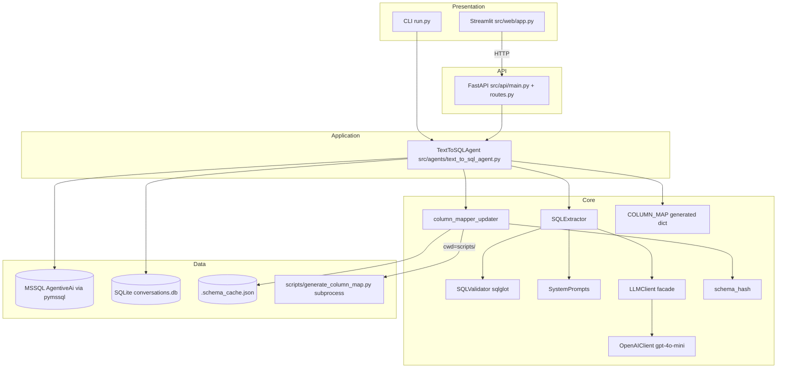

# Current Architecture — As Implemented

> This document reconstructs the architecture **as it exists in code today** (commit `e6b53d6`), not the desired future architecture.
> Each claim is backed by a source reference.

---

## 1. High-level shape

The system is a **single monolithic agent object** (`TextToSQLAgent`) shared by three thin frontends (CLI, FastAPI, Streamlit-via-API). There is no service layer, no domain model, no dependency injection; the API holds one module-global instance, and the CLI creates its own.

## 2. Layer inventory

### 2.1 Presentation layer — EXISTS (minimal)
- `src/web/app.py`: Streamlit chat page. Manages `st.session_state.messages` / `session_id`, renders assistant Markdown with `unsafe_allow_html=True`, pandas DataFrame for rows, expander for SQL, RTL CSS injected globally (`app.py:58-177`).
- `run.py`: stdin/stdout REPL (`run.py:5-34`).

### 2.2 API layer — EXISTS (single endpoint)
- `src/api/main.py:11-25`: FastAPI app, permissive CORS (`allow_origins=["*"]`, `allow_credentials=True`).
- `src/api/routes.py:13-19`: module-global singleton `agent_instance` created lazily inside async handlers.
- Endpoints: `POST /api/v1/ask`, `GET /api/v1/health`. All errors are swallowed into HTTP 200 envelopes with `success=false` (`routes.py:21-47`) — intentional per inline comment.

### 2.3 Application/orchestration layer — EXISTS but concentrated in one class
- `src/agents/text_to_sql_agent.py` does everything: construction/wiring (`__init__`, lines 24–34), session management (`ask`, 66–70), history fetch (74), SQL generation (77), execution (81), row filtering + Persian translation (`_filter_and_translate_rows`, 36–63), answer generation (85–93), memory persistence (96–97), response assembly (99–107), and error-to-response mapping (109–139).

### 2.4 Core layer — partially decomposed
- SQL generation: `SQLExtractor` (prompt → LLM → clean → validate → retry loop) — `sql_extractor/extractor.py`.
- Validation: `SQLValidator` — prefix check + keyword blocklist + `sqlglot` parse only. No schema/semantic/security-depth validation.
- Prompts: `SystemPrompts` static string builders — `core/prompts.py`.
- Schema knowledge: hand-written `FULL_SCHEMA` constant — `database/models.py:81-125`.
- Column translation map + schema-hash change detection — `column_mapper.py`, `column_mapper_updater.py`, `schema_hash.py`.

### 2.5 Database layer — EXISTS (thin)
- `DatabaseConnection` wraps `pymssql`; single connection, single `as_dict=True` cursor reused for every query; `execute_query` always `fetchall()`; connect-time `timeout=5` seconds (query timeout); no pool, no retry, no statement timeout separate from connection config (`connection.py:19-56`).

### 2.6 Memory layer — EXISTS (simple SQLite)
- `MemoryManager` with `sessions`/`messages` tables in `data/conversations.db`; last-5-message retrieval by `created_at DESC` reversed; FK declared but SQLite enforcement not enabled; the planned index on `(session_id, created_at)` was commented out before commit (`manager.py:36-41`).

### 2.7 LLM layer — EXISTS but effectively single-provider
- Facade `LLMClient` wraps only `OpenAIClient` (`gpt-4o-mini`, temperature 0.1, `max_tokens=500`). Gemini/Groq/Ollama client files exist but are dead code. "Fallback" does not exist anywhere in code.

## 3. The five runtime flows

### 3.1 SQL generation flow (current)
1. `SystemPrompts.sql_generation_prompt(question, history)` builds ONE user-role message containing: `FULL_SCHEMA`, 16 numbered rules, 5 few-shot examples, optional raw conversation history (last 5 messages), then the question (`prompts.py:11-60`).
2. `LLMClient.generate(prompt)` pings `https://api.openai.com` (internet check), then calls OpenAI ChatCompletion (`client.py:26-43`).
3. `_clean_sql()` strips markdown fences, cuts everything before the first `SELECT`/`WITH`, strips trailing `;` (`extractor.py:17-40`).

### 3.2 Validation flow (current)
1. Non-empty; starts with SELECT/WITH (`validator.py:24-25`).
2. Regex word-boundary blocklist: DROP, DELETE, UPDATE, INSERT, ALTER, CREATE, EXEC, EXECUTE (`validator.py:28-31`).
3. `sqlglot.parse_one(dialect="tsql")` must parse (`validator.py:33-41`).
4. On failure: up to 1 repair attempt via `error_correction_prompt` (initial call + repair = max 2 LLM calls; `extractor.py:42-71`). Repair prompts contain only the error text + invalid SQL + question — **not** the full rules/schema/few-shots of the original prompt.

### 3.3 Execution flow (current)
- Single validated string sent to the shared cursor; `fetchall()` unbounded; rows as list of dicts; any `pymssql` exception bubbles as-is (`connection.py:43-56`). There is no row limit, no execution timeout beyond the connect option, no transaction control for reads.

### 3.4 Result processing flow (current)
- `_filter_and_translate_rows()`: drops keys ending in `Id` (and `Id`), maps remaining keys through static `COLUMN_MAP`, falls back to original name with a WARNING log (`text_to_sql_agent.py:36-63`). Computed/aliased columns (e.g., `total_sales`, `order_month`, `delivered_quantity`) are usually missing from the map → English labels leak into Persian tables. Log evidence shows this fired 2,510 times on Aug 21, 2026 alone.
- Empty result ⇒ fixed English sentence `"No data found for your query."` (`text_to_sql_agent.py:85-86`) — no LLM call, not Persian.

### 3.5 Answer generation flow (current)
- If rows exist: `natural_response_prompt(question, first-5-rows-as-python-dict-repr, row_count)` → same OpenAI client → free-form Markdown expected to follow a rigid 4-section format (`prompts.py:63-88`). Output is stored verbatim as the assistant message.

## 4. What is implemented vs partial vs documented-only

| Capability | Status | Evidence |
|---|---|---|
| NL→T-SQL via one LLM provider | **Implemented** | `client.py`, `openai_client.py` |
| SQL cleaning heuristics | **Implemented** (lossy) | `extractor.py:17-40` |
| Syntax validation (sqlglot tsql parse) | **Implemented** | `validator.py:33-41` |
| Keyword blocklist security | **Partially implemented** — bypassable via multi-statement queries using non-blocked keywords (e.g. `TRUNCATE`, `OPENROWSET`, `GRANT`, `SHUTDOWN`); empirically verified during Sprint 0 inspection | `validator.py:27-31` |
| Validation repair loop | **Implemented** (validation errors only; execution errors never repaired) | `extractor.py:50-69`, logs |
| Conversation memory (SQLite) | **Implemented** (no cleanup, ambiguous ordering within same second) | `manager.py` |
| Persian column translation | **Partial** — static generated map; wrong entry for `mesc`; aliases untranslated | `column_mapper.py`, agent logs |
| Schema-change detection | **Implemented but broken in effect** — regeneration writes to `scripts/src/core/column_mapper.py` due to CWD-relative output path | `column_mapper_updater.py:30-56`, `generate_column_map.py:104-108`, stray tracked file `scripts/src/core/column_mapper.py` |
| Multi-provider fallback (README claim) | **Documentation only** — no code path instantiates Groq/Gemini/Ollama | grep: zero call sites |
| Auto-repair of DB execution errors (README claim "اصلاح خودکار در صورت خطا") | **Documentation overstates code** — repair loop covers validator rejections only | `extractor.py`, `logs/app_20260821.log` |
| Shipments-aware answering | **Partial** — table exists in few-shots/rules only implicitly; `FULL_SCHEMA` omits Shipments columns entirely | `models.py:81-125` |
| Tests | **Absent** — empty packages only | `tests/**/__init__.py` (0 bytes) |
| Observability/tracing/eval harness | **Absent** | see `observability-audit.md` |
| `src/schemas/` package | **Absent content** | empty `__init__.py` |

## 5. Architectural characteristics worth recording

1. **One shared mutable agent** behind the API: DB cursor, LLM client, memory manager all shared across concurrent requests; handlers are `async def` but execute blocking network/DB calls synchronously, so Uvicorn serializes requests on the event loop (`routes.py:22-29`).
2. **Startup side effects**: constructing an agent connects to the DB and may spawn an LLM-driven subprocess that regenerates Python source code at runtime (`column_mapper_updater.py`, `generate_column_map.py`).
3. **Schema knowledge duplication**: the true schema lives in MSSQL; a hand-written copy lives in `FULL_SCHEMA`; a machine-generated translation lives in `COLUMN_MAP`; three sources drift independently (already diverged: `mesc` translation, missing Shipments section).
4. **No abstraction boundaries**: agents import concrete classes directly; `BaseLLMClient` exists but the used client does not implement it; exceptions hierarchy exists but is unused.
5. **Statefulness through files**: `.schema_cache.json`, `data/conversations.db`, `logs/*.log`, and even generated source code are part of runtime state, all relative to the working directory.
