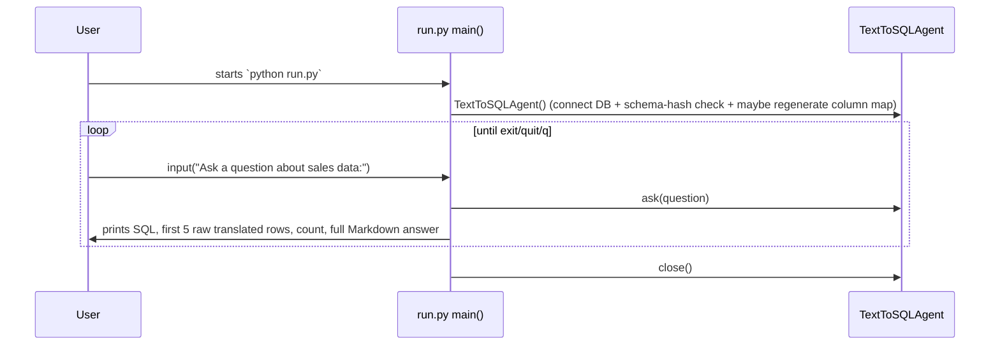
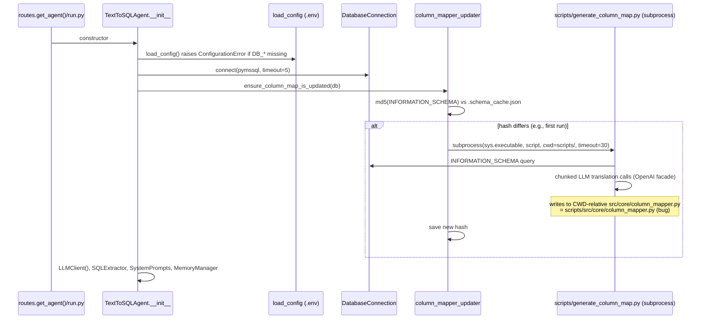

# End-to-End Data Flow — Current Implementation

> Traces of the exact runtime paths as coded today. File:symbol references included.

---

## 1. FastAPI + Streamlit request (primary production path)

The UI never touches the database or LLM directly; it is a thin HTTP client.

```mermaid
sequenceDiagram
    autonumber
    participant U as User browser
    participant ST as Streamlit app.py
    participant API as FastAPI routes.py /ask
    participant AG as TextToSQLAgent.ask
    participant MEM as MemoryManager (SQLite)
    participant EX as SQLExtractor
    participant LC as LLMClient→OpenAI
    participant VAL as SQLValidator (sqlglot)
    participant DB as MSSQL via pymssql

    U->>ST: types question
    ST->>API: POST /api/v1/ask {question, session_id} (timeout 60s)
    API->>AG: ask(question, session_id)
    AG->>MEM: session_exists? / create_session()
    AG->>MEM: get_history(session_id, limit=5)
    AG->>EX: extract(question, history)
    EX->>LC: generate(sql_generation_prompt)
    Note over LC: ping api.openai.com first,<br/>then chat.completions.create<br/>(gpt-4o-mini, temp 0.1, max_tokens 500)
    LC-->>EX: raw text
    EX->>EX: _clean_sql()
    EX->>VAL: validate(sql)
    alt invalid and retries left (< 2 total attempts)
        EX->>LC: generate(error_correction_prompt)
        EX->>VAL: validate(repaired sql)
    end
    VAL-->>AG: ok (or SQLValidationError raised)
    AG->>DB: cursor.execute(sql); fetchall()
    DB-->>AG: rows[dict]
    AG->>AG: _filter_and_translate_rows(rows)  (drop *Id, map COLUMN_MAP)
    alt no rows
        AG-->>AG: answer = "No data found for your query."
    else rows exist
        AG->>LC: generate(natural_response_prompt(question, first 5 rows, row_count))
        LC-->>AG: Persian Markdown answer
    end
    AG->>MEM: add_message(user, question); add_message(assistant, answer)
    AG-->>API: result dict {success, sql, answer, rows, row_count, session_id}
    API-->>ST: HTTP 200 AskResponse (always, even on error envelope)
    ST->>U: st.markdown(answer) + st.dataframe(rows) + SQL expander
```

Step-by-step notes with code anchors:

1. **UI state** (`src/web/app.py:20-24`): `messages` list + `session_id` kept in `st.session_state`. Sidebar "Start New Session" resets both locally only; server-side session is orphaned.
2. **HTTP call** (`app.py:27-51`): `requests.post(f"{API_URL}/ask", json={question, session_id}, timeout=60)`; non-200 → `st.error`; ConnectionError → friendly message.
3. **Endpoint** (`src/api/routes.py:21-47`): builds agent singleton on first call; wraps everything; returns `AskResponse(**result)` with status 200 even when `success=false` (explicit inline comment).
4. **Session handling** (`src/agents/text_to_sql_agent.py:66-70`): missing id → create; unknown id → silently replaced by a new one (client keeps old id only if response carries none).
5. **Memory retrieval** (`src/memory/manager.py:63-73`): last 5 messages ordered by `created_at DESC`, then reversed → chronological. Same-second ties are ambiguous (see memory-audit).
6. **Prompt construction**: see §3 below.
7. **LLM invocation**: internet ping precedes every call (`src/core/llm/client.py:26-32`), then blocking OpenAI call.
8. **Extraction/cleaning** (`sql_extractor/extractor.py:42-69`).
9. **Validation** (`validator.py:15-43`).
10. **Execution** (`database/connection.py:43-56`): unbounded fetchall on shared cursor.
11. **Row processing** (`text_to_sql_agent.py:36-63`): drop keys ending `Id`; translate via static map; WARNING per unseen missing column.
12. **Answer generation** (`prompts.py:63-88`): first 5 rows embedded as Python dict reprs.
13. **Persistence** (`manager.py:52-61`): two inserts in two separate connections; session `updated_at` bumped.
14. **Response**: dict → Pydantic `AskResponse` → JSON.
15. **Rendering**: answer markdown rendered with HTML allowed; DataFrame re-renders the same rows (duplicate presentation); SQL behind expander; errors appended to history as assistant messages.

## 2. CLI execution flow (`run.py`)



Notable divergence: the CLI passes no `session_id`, so **every CLI question creates a new session** — conversation memory exists but is never used from this entry point (`run.py:16`).

## 3. Agent processing internals (prompt assembly detail)

`sql_generation_prompt` final layout (in order):

1. Role statement ("expert in T-SQL…")
2. `FULL_SCHEMA` — hand-written description of Orders + OrderItems only (Shipments absent)
3. 16 STRICT rules (TOP not LIMIT, GETDATE, jalaliYearNo, operationMonth grouping, aliases, revenue formula `quantity*unitPrice`, table allowlist, FK join conditions, HAVING rule, conditional counting, LEFT JOIN guidance, count-vs-sum disambiguation)
4. History-handling meta-instructions
5. 5 few-shot examples (question + SQL pairs)
6. Optional raw history block (last 5 messages verbatim)
7. Current question + "**SQL query:**" cue

`natural_response_prompt` layout: role ("explain results in Persian"), the question, "Results:" header with row_count and first ≤5 rows as Python dict reprs, rigid output contract (4 sections, pure Markdown, no code fences).

`error_correction_prompt`: error text + invalid SQL + original question + "Follow the schema and rules strictly" (without actually including schema/rules).

## 4. Memory persistence flow

```mermaid
sequenceDiagram
    participant AG as TextToSQLAgent
    participant M as MemoryManager
    participant S as SQLite conversations.db
    AG->>M: create_session() [only if needed]
    M->>S: INSERT INTO sessions (uuid4)
    AG->>M: get_history(sid, 5)
    M->>S: SELECT role,content ORDER BY created_at DESC LIMIT 5 (reversed in Python)
    AG->>M: add_message(sid,"user",q)      -- connection #1
    M->>S: INSERT messages; UPDATE sessions.updated_at
    AG->>M: add_message(sid,"assistant",answer) -- connection #2
    M->>S: INSERT messages; UPDATE sessions.updated_at
```

No cleanup path is ever invoked (`clear_session` unused; UI reset is client-side only).

## 5. Startup flow (agent construction)



Consequences: first request after any schema change can take tens of seconds and requires working OpenAI connectivity just to start answering; failure inside the updater is logged and ignored (returns False, caller ignores).

## 6. Health-check flow

`GET /api/v1/health` (`routes.py:49-65`) → constructs agent if needed → reports `"Connected"` iff `agent.db.connection` truthy, `"Available"` iff `llm.is_available()` (which performs a live `api.openai.com` request). Any exception → status "error". The endpoint therefore performs network I/O and can be slow.
