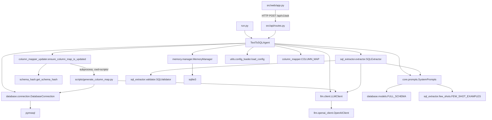

# Repository Map — Current System

> Sprint 0 discovery artifact. Based on the actual source tree at commit `e6b53d6` ("adding memory").
> Facts are derived from reading the source code; assumptions are explicitly labeled.

---

## 1. Overview

The repository is a small Python MVP (~30 source files) implementing a Persian-language Text-to-SQL agent over a Microsoft SQL Server `Sale` schema. It exposes:

- a CLI loop (`run.py`),
- a FastAPI service (`run_api.py` → `src/api/main.py`),
- a Streamlit chat UI (`src/web/app.py`, launched by `run_ui.py` or directly via `streamlit run`).

The single runtime pipeline is: **question → LLM-generated T-SQL → validation → execution → row filtering/Persian translation → LLM answer generation**.

## 2. Top-level layout

| Path | Type | Purpose |
|---|---|---|
| `run.py` | Entry point | Interactive CLI loop. Instantiates `TextToSQLAgent`, reads questions from stdin, prints SQL, first 5 rows, and the generated answer. |
| `run_api.py` | Entry point | Starts Uvicorn for `src.api.main:app` on `0.0.0.0:8000` with `reload=True` (dev mode). |
| `run_ui.py` | Entry point | Alternative launcher that runs Streamlit on `0.0.0.0:8501` programmatically. |
| `pyproject.toml` | Config | Project metadata + dependency list (`uv`-managed). No dev/test dependencies, no tool configuration (no lint/typecheck/test config at all). |
| `uv.lock` | Lockfile | Locked dependency resolution (~675 KB). |
| `.python-version` | Config | Pins Python `3.11`. |
| `.env.example` | Config | Template of required env vars. **Contains concrete-looking infrastructure values rather than placeholders (see discrepancies).** Secrets masked here. |
| `.env` | Runtime config | Real credentials (untracked via `.gitignore`). Never documented. |
| `.gitignore` | Config | Excludes `.env`, `logs/`, `data/`, `.schema_cache.json`, caches. Note: it lists `*.db`, `data/`, `reports/`, `*.txt`. |
| `.schema_cache.json` | Generated/runtime | Cached MD5 hash of the DB schema used to detect schema changes (`{"schema_hash": "<md5>"}`). Untracked. |
| `README.md` | Documentation | Persian setup/usage guide. Several claims diverge from code (see `discrepancies.md`). |
| `report.md` | Documentation | A manual test report (Persian) describing two ad-hoc tests (one analytical success, one rejected DELETE). Not referenced by any code. |
| `data/conversations.db` | Runtime data | SQLite database created by `MemoryManager` (sessions + messages). Untracked. At time of inspection: 14 sessions, 48 messages. |
| `logs/app_YYYYMMDD.log` | Runtime data | Daily log files written by `src/utils/logger.py`. Three files present (Aug 21–23, 2026). Untracked. |
| `tests/` | Tests | **Empty.** Only `__init__.py` files under `tests/`, `tests/test_database/`, `tests/test_llm/`, `tests/test_sql_extractor/`. Zero test functions exist. |

## 3. Source layout (`src/`)

### `src/agents/`
| File | Responsibility |
|---|---|
| `text_to_sql_agent.py` | The entire application orchestration in one class: builds DB connection + LLM client + extractor + prompts + memory; runs session handling, SQL generation, execution, row filtering/translation, answer generation, memory persistence, and result-dict assembly. This is the de-facto "application layer". |

### `src/api/`
| File | Responsibility |
|---|---|
| `main.py` | FastAPI app factory: CORS middleware (`allow_origins=["*"]`), mounts router under `/api/v1`, root health message. |
| `routes.py` | `/api/v1/ask` and `/api/v1/health` endpoints. Holds a module-global lazy singleton `agent_instance` (one shared `TextToSQLAgent`). Converts every failure into HTTP 200 with `success=false` envelope. |
| `models.py` | Pydantic request/response models: `AskRequest{question, session_id?}`, `AskResponse{success, question, answer?, sql?, row_count?, rows?, error?, session_id?}`, `HealthResponse{status, database, llm}`. |

### `src/core/`
| File | Responsibility |
|---|---|
| `prompts.py` | `SystemPrompts` static methods producing the three prompt strings: SQL generation, natural-language response, error correction. The heart of all LLM behavior. |
| `column_mapper.py` | Auto-generated Persian translation dict `COLUMN_MAP` (English column name → Persian label) + `get_column_mapping()` helper. Header states "Do not edit manually". |
| `column_mapper_updater.py` | Schema-change detection glue: loads/saves `.schema_cache.json`, compares hashes, re-runs the generator script via `subprocess` when the schema changes. Called once during agent startup. |
| `schema_hash.py` | Computes an MD5 hash over `INFORMATION_SCHEMA.COLUMNS` rows for the three `Sale` tables. |
| `__init__.py` | Re-exports `COLUMN_MAP`. |

### `src/core/database/`
| File | Responsibility |
|---|---|
| `connection.py` | `DatabaseConnection`: raw `pymssql` wrapper. One connection + one cursor (`as_dict=True`) per agent instance; `execute_query` (fetchall) and `execute_non_query` (commit/rollback, currently unused anywhere). |
| `models.py` | Hard-coded schema knowledge: three table dicts (`ORDERS_MODEL`, `ORDER_ITEMS_MODEL`, `SHIPMENTS_MODEL`), `build_compact_schema()`, and `FULL_SCHEMA` — a hand-written English description of `Sale.Orders` and `Sale.OrderItems` injected into the SQL prompt. **`Sale.Shipments` columns are absent from `FULL_SCHEMA`.** |

### `src/core/llm/`
| File | Responsibility |
|---|---|
| `base.py` | `BaseLLMClient` ABC (`generate`, `is_available`). Only `OllamaClient` implements it. |
| `client.py` | `LLMClient`: the facade actually used everywhere. Wraps **only** `OpenAIClient`; pings `https://api.openai.com` before every call as an internet check; raises `RuntimeError` on failure. No fallback logic despite its design suggesting one existed. |
| `openai_client.py` | Thin OpenAI ChatCompletion wrapper. Model `gpt-4o-mini`, temp 0.2 (overridden to 0.1 by `LLMClient`), `max_tokens=500`, honors `OPENAI_BASE_URL` override. |
| `gemini_client.py` | `GeminiClient` (`google-genai`, model `gemini-2.5-flash`, temp 0.2, 500 tokens). **Never instantiated anywhere.** Does not implement `BaseLLMClient`. |
| `groq_client.py` | `GroqClient` (`langchain_groq.ChatGroq`, model `llama-3.3-70b-versatile`, temp 0.2, 500 tokens, retries 2). **Never instantiated.** Not a `BaseLLMClient`. |
| `ollama_client.py` | `OllamaClient` (`langchain_ollama.OllamaLLM`, model `llama3.1:8b`, temp 0.2). **Never instantiated** by current code (older log entries show a previous `LLMClient` attempted to construct it with an unsupported `max_tokens` argument and failed). |

### `src/core/sql_extractor/`
| File | Responsibility |
|---|---|
| `extractor.py` | `SQLExtractor.extract()`: prompt construction → LLM call → `_clean_sql()` markdown/text stripping → validation retry loop (`max_retries=2`) using `error_correction_prompt`. Also contains `_clean_sql()` heuristics. |
| `validator.py` | `SQLValidator.validate()`: SELECT/WITH prefix check, keyword blocklist (DROP/DELETE/UPDATE/INSERT/ALTER/CREATE/EXEC/EXECUTE), `sqlglot.parse_one(dialect="tsql")` syntax parse. Raises `SQLValidationError(message, sql)`. |
| `few_shots.py` | `FEW_SHOT_EXAMPLES`: 5 Persian question → T-SQL pairs (top buyers, product-group sales, average order value, order counts by group, monthly totals). |

### `src/memory/`
| File | Responsibility |
|---|---|
| `manager.py` | `MemoryManager`: SQLite persistence in `data/conversations.db` (`sessions`, `messages` tables), `create_session`, `add_message`, `get_history(limit)` (ORDER BY created_at DESC then reversed), `clear_session` (never called by any caller), `session_exists`. New connection opened per operation. |

### `src/utils/`
| File | Responsibility |
|---|---|
| `config_loader.py` | `load_config()`: maps `DB_HOST/DB_PORT/DB_USER/DB_PASSWORD/DB_NAME` env vars into kwargs for `DatabaseConnection`; raises local `ConfigurationError` if missing. |
| `exceptions.py` | Intended hierarchy `TextToSQLException` → `ConfigurationError/DatabaseConnectionError/QueryExecutionError/SQLValidationError/LLMError`. Mostly dead: only `QueryExecutionError` is imported (and never raised); `SQLValidationError` actually used comes from `sql_extractor.validator`, not from here. |
| `logger.py` | `get_logger(name)`: per-module logger, INFO console handler + DEBUG daily file handler under `logs/`. |

### `src/web/`
| File | Responsibility |
|---|---|
| `app.py` | Streamlit chat UI: RTL CSS injection, session-state chat buffer, sidebar session reset, calls the REST API over HTTP (`POST {API_URL}/ask`, 60 s timeout), renders answer Markdown (unsafe HTML allowed), pandas DataFrame of rows, SQL expander, error boxes. |

### Other directories
| Path | Purpose |
|---|---|
| `scripts/generate_column_map.py` | Standalone generator: reads column names from `INFORMATION_SCHEMA`, chunks them (15/request), asks the LLM for a JSON Persian translation map, writes `src/core/column_mapper.py`. Uses a **cwd-relative** output path. |
| `scripts/src/core/column_mapper.py` | **Stray artifact**: an older generated `column_mapper.py` written to the wrong location because the script resolves its output path relative to the process CWD when invoked by `column_mapper_updater` (which sets `cwd=scripts/`). Tracked in git — hard evidence of the path bug. Contents differ slightly from the active map (e.g., `jalaliYearNo` translated differently). |
| `src/schemas/` | Empty package (`__init__.py` only). No content. |

## 4. Import / call graph (actual)

Modules compiled but **never imported by runtime code**: `llm/gemini_client.py`, `llm/groq_client.py`, `llm/ollama_client.py`, `llm/base.py` (only ollama imports it), `utils/exceptions.py` (except one unused import), most of `database/models.py` (only `FULL_SCHEMA` used).

## 5. Runtime/generated artifacts

| Artifact | Producer | Consumer |
|---|---|---|
| `data/conversations.db` | `MemoryManager` | `MemoryManager` only |
| `logs/app_*.log` | `utils.logger.get_logger` | humans only |
| `.schema_cache.json` | `column_mapper_updater._save_cache` | same module |
| `src/core/column_mapper.py` | `scripts/generate_column_map.py` (manual run writes correct path; startup-triggered run writes wrong path) | `text_to_sql_agent.py`, `core/__init__.py` |

## 6. Entry points summary

| Command | What happens |
|---|---|
| `uv run python run.py` | CLI REPL; one agent process; direct function calls; no server. |
| `uv run python run_api.py` | Uvicorn dev server on port 8000; agent lazily created on first `/ask` or `/health`. |
| `uv run streamlit run src/web/app.py` (or `uv run python run_ui.py`) | Streamlit on port 8501; talks to the API over HTTP; requires the API to be running. |
| `uv run python scripts/generate_column_map.py` | One-shot column-map regeneration (requires DB + working LLM). |
